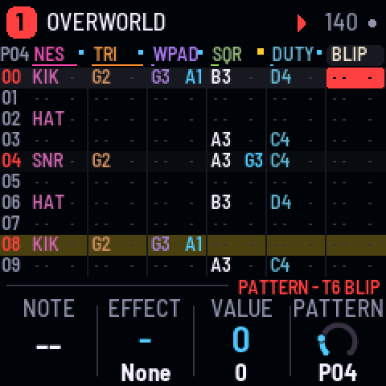
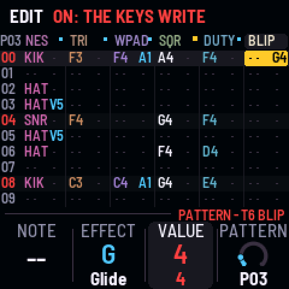
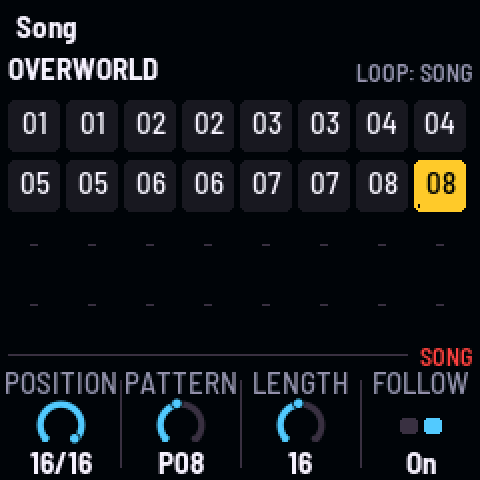
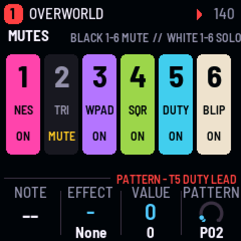

# BIT-1 for the M-VAVE FM-1 (experimental)

BIT-1 turns the M-VAVE FM-1 into a generative 8-bit tracker. Six tracks of sixteen rows, a note and an effect
a cell, patterns chained into a song, played by chip voices: an NES-style pulse and stepped triangle, Game
Boy-style 4-bit waves, an LFSR noise, long or metal, SID-style saws and pulses through a resonant filter, and a
two-op FM ring bell, with sixteen steps of volume and arpeggios at frame rate, through a ping-pong echo, a
plate and Lo-fi. Follow writes the other tracks from a melody you write (bass, chords, an arp, a harmony, a
counter-line, drums, each a new take when you like), or none of it. Evolve lets each pattern drift a little on
every pass; Grow writes one in eight chip styles. A RedtailWorks project, alongside HYP-1 in this repository.

> **Experimental.** Built and tested in the simulator and the browser emulator, not yet on a real FM-1.
> Versions are 0.x until it has been. Install it at your own risk; HYP-1 or M-VAVE's firmware goes back on
> the same way.

| | |
|---|---|
|  |  |
|  |  |

- **Try it in the browser:** <https://rustypawz.github.io/fm1-HYP1/bit/emu/>: with sound, MIDI in and
  out, and eight channels (the tracks apart) for your DAW.
- **Install it** (Chrome or Edge, the FM-1 plugged in): <https://rustypawz.github.io/fm1-HYP1/bit/install/>
- **Manual:** <https://rustypawz.github.io/fm1-HYP1/bit/manual/> (source: [docs/MANUAL.md](docs/MANUAL.md))

## In short

| | |
|---|---|
| Keys | The cursor's track (a kit: white keys 1–8 its drums). With REC on, they write and the cursor steps down; playing, into the row playing |
| PLAY · REC · EDIT | Play / stop (SEL: from the row) · edit · clear the cell (SEL: a note-off; on Grow: grow; on Follow: a new take, SEL: write it in; on Song: a fresh copy) |
| HOME · SEQ · ENV · LFO · ARP · GLO | Pattern · Song · Sound (again: Move, Sends) · Space (again: Groove) · Grow (again: Follow) · Setup (again: Device) |
| SELECT · ALGORITHM · PRESETS | The row (Song: the position; HOME held: tempo) · the track · the song (five) |
| KNOB 1–4 | The page's values; on Pattern, the cell's note, effect and value, and the position's pattern |
| FX · SEL | Mute the track (held: black keys mute, white keys solo) · follow the song (held: shift) |
| OCT− / OCT+ | The keys' octave (SEL: the cell a semitone) |
| SAVE | Save the song; held on Setup: the song as it came |

**Sixteen effects:** Glide, Chance, Ratchet, Delay, Tone, Volume, Bend, Echo throw, Chord, Mutate, Length,
Crush, Stutter, Swell, Jump. **Twenty-four sounds:** three kits (NES, GB, SID), Tri bass, Pulse bass, SID bass,
Wave bass, Octave bass, Square, Thin lead, Duty lead, SID lead, Wave lead, Chip arp, Wave pad, SID pad, Organ,
Ring bell, Blip, Laser, Power-up, Pickup, Metal, Noise sweep. **Five songs,** each one chip's: Overworld (NES),
Dungeon (Game Boy), Starfield (SID), Boss Rush (NES), Lullaby (Game Boy).

**To your DAW:** MIDI clock in (USB or TRS) drives the rows, six ticks a row; MIDI out sends each track's notes
on its own channel, and the clock when asked. Notes in play and write the cursor's track.

## The sound

Every sound is synthesised as it plays, not sampled: no audio from any game or album is in this tree. The
chip voices follow the old chips' ways rather than copying them: a pulse at 12.5, 25 or 50% (Tone steps the
duty), a triangle and 32-step 4-bit waves (saw, GB, organ, hollow), an LFSR noise whose long mode hisses and
whose short mode rings at a pitch, SID-style saws and pulses with PWM through a resonant filter, and a two-op
FM ring bell. They step their volume in sixteen levels; a track's Arp plays its note as a fast arpeggio in the
song's scale, stepping at the song's Arp rate (one to three frames at 60 Hz, or a 1/32 or 1/16 on the tempo).

## Storage

Each song is its own flash object (3.3 KB: sixteen patterns of 16 × 6 cells of two bytes, the order list,
the song's settings), with Felucca's A/B copies so a power cut mid-save keeps the last good one. Songs 1–4
live at 0x97000–0x9EFFF and song 5 at 0xDE000, clear of the sample slots (0xA0000–0xDBFFF) M-VAVE's own
firmware keeps; the device's settings are in the project object at 0xFC000.

## Building

Self-contained in this folder: see [BUILDING.md](BUILDING.md). HYP-1's workflow
(`../.github/workflows/firmware.yml`) builds it on every push, after HYP-1. Licensing:
[LICENSING.md](LICENSING.md) (GPL-3.0-only).

BIT-1 is a fork of [AMB-1](https://github.com/charlesvestal/fm1-amb) by Charles Vestal, by way of HYP-1,
GRAV-1, CTY-1 and EVOL-1, on [Felucca](https://github.com/hugelton/Felucca) by Leo Kuroshita (@kurogedelic),
Hügelton Instruments. Tracker ideas after [KAWA](https://github.com/Guizmoh/Kawa-Tracker-Fm1) by Omnipotard
(GPL-3.0). M-VAVE and FM-1 are trademarks of their owners; BIT-1 is not affiliated with M-VAVE.
