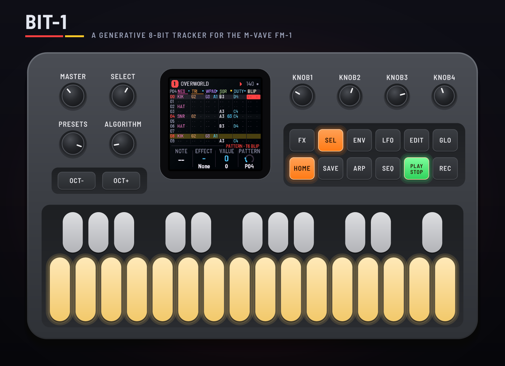
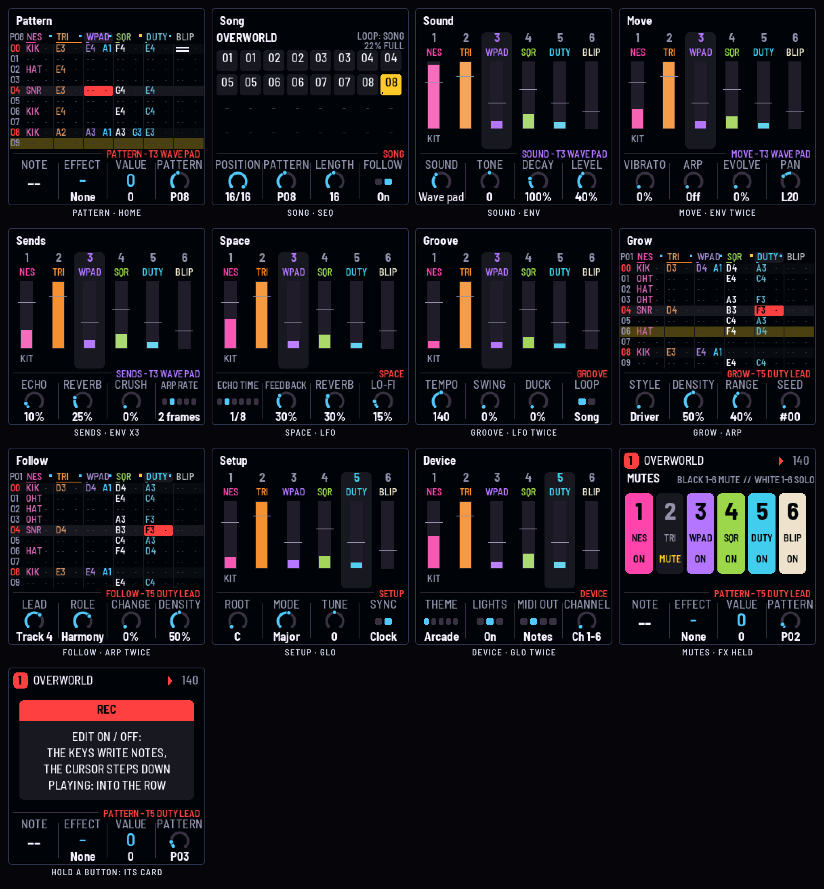
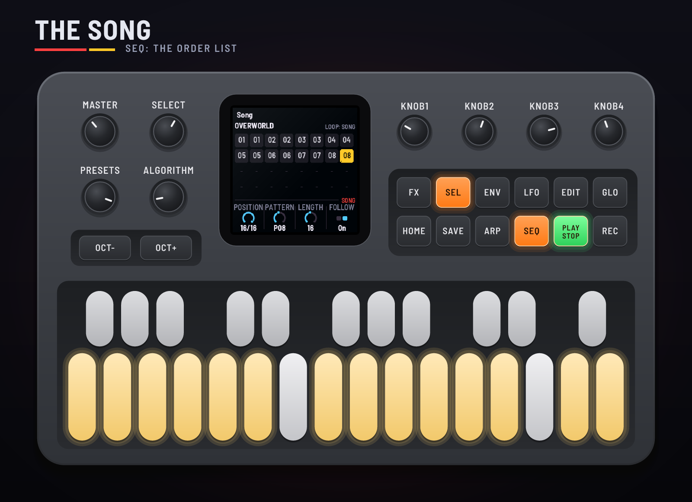
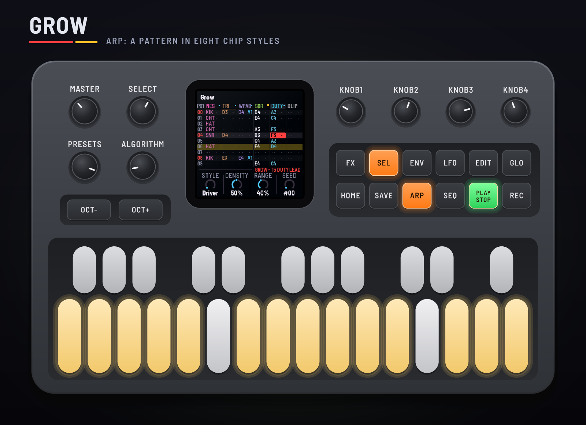
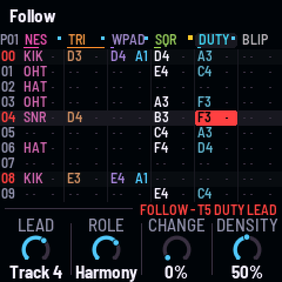
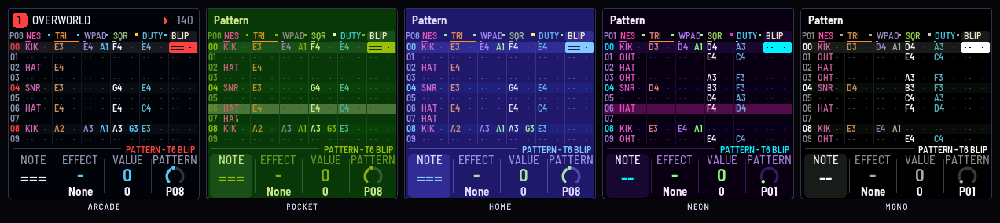
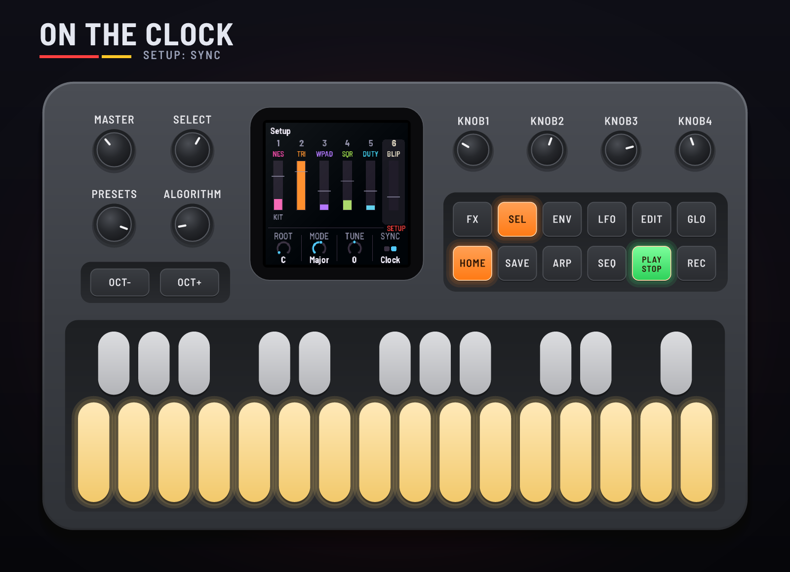
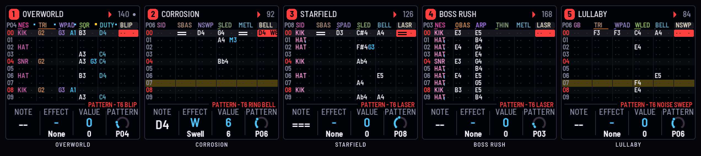

# BIT-1

BIT-1 turns the M-VAVE FM-1 into a generative 8-bit tracker. You write notes into a grid of six tracks and
sixteen rows, one effect a cell, and chain the patterns into a song. The tracks play chip voices: an NES-style
pulse and stepped triangle, Game Boy-style 4-bit waves, an LFSR noise, SID-style saws and pulses through a
resonant filter, and a two-op FM ring bell, with sixteen steps of volume and arpeggios at frame rate, through a
ping-pong echo, a plate and Lo-fi. Evolve lets a pattern drift a little on every pass; Grow writes one in eight
chip styles; Follow writes the other tracks from a melody you write: bass, chords, an arp, a harmony, a
counter-line, drums.

This manual covers BIT-1 version 0.1.0.

> **Experimental.** BIT-1 is new: it has been built and tested in the simulator and the browser emulator,
> not yet on a real FM-1. Install it at your own risk; HYP-1, or M-VAVE's own firmware, goes back on the
> same way.

---

## Contents

1. Install
2. Getting started
3. Controls
4. The screen
5. Writing a pattern
6. The song
7. The sounds
8. The effects
9. Evolve, Grow and Follow
10. The pages
11. MIDI clock and your DAW
12. Saving and the songs
13. Troubleshooting
14. Credits

---

## 1. Install

**Try it first:** the emulator runs the same code in the browser, with sound, played with the mouse, a
touch screen or the keyboard.

**Install:** open the installer in Chrome or Edge, connect the FM-1 with a USB data cable and press
Install. Don't unplug it while it's writing; when it finishes, the FM-1 restarts into BIT-1.

From the command line instead (needs `pip3 install mido python-rtmidi`):
`python3 tools/fm1_install.py bit1-VERSION.fwsc`, with the file from the site's download.

**Go back:** "Back to the stock firmware", at the bottom of the installer, puts M-VAVE's firmware back.
M-VAVE's own updater, M-UPGRADE, works too. BIT-1 keeps its songs clear of the flash M-VAVE's firmware uses
for samples.

> Installing other firmware is at your own risk. If the FM-1 won't start, hold OCT− and OCT+ together for
> five seconds for the update mode, then install again.

---

## 2. Getting started

BIT-1 plays from the moment it's on: the first song, Overworld, from its intro. Then:

1. Press **PLAY** to stop it. You're on the **Pattern** page (HOME): the grid of the pattern at the song's
   first position.
2. Turn **SELECT** to move down the rows, **ALGORITHM** across the tracks. The cursor's cell is boxed.
3. Play the **keys**: they play the cursor's track. On a kit's track the white keys are its eight drums.
4. Press **REC**. Now each key writes its note into the cell and the cursor steps down a row. Write a few.
5. Press **PLAY**: the pattern plays from the top, the row playing lit yellow. Write while it plays and
   the notes go into the row that's playing.
6. Turn **KNOB 2** on a cell with a note: an effect. **KNOB 3** its value. Try R (Ratchet) or B (Bend).
7. Press **SAVE** to keep the song.

Hold any button for a second and a card says what it does.

---

## 3. Controls

| Control | What it does |
| --- | --- |
| Keys | The cursor's track (a kit: white keys 1–8 its drums). With REC on, on Pattern, Grow or Follow, they write |
| PLAY | Play from the top of the position on screen / stop. SEL + PLAY: from the cursor's row |
| REC | Edit: the keys write notes, and the cursor steps down |
| EDIT | Clear the cell (and step down, with REC on). SEL + EDIT: a note-off. On Grow, Follow and Song, see there |
| SEL | Follow on / off (the screen follows the song as it plays); held, a shift |
| FX | Mute the cursor's track; held, the mutes: black keys 1–6 mute, white keys 1–6 solo |
| SELECT | The row (with SEL: four at a time); on Song, the position; elsewhere every page in turn. HOME + SELECT: tempo |
| ALGORITHM | The track (the cursor's, on every page) |
| PRESETS | The song (five) |
| HOME · SEQ · ENV · LFO · ARP · GLO | Pattern · Song · Sound (again: Move, Sends) · Space (again: Groove) · Grow (again: Follow) · Setup (again: Device) |
| KNOB 1–4 | The page's four values. On Pattern: the cell's note, effect and value, and the position's pattern |
| OCT− / OCT+ | The keys an octave down / up. With SEL, the cell's note a semitone |
| SAVE | Save the song (and the device's settings). Held 1.5 s on Setup: the song as it came |
| SEL + GLO | Remote: the FM-1's panel plays BIT-1 in the browser emulator |

---

## 4. The screen

The **header** shows the song's number and name, REC when you're writing, play or stop, and the tempo (EXT
and the clock's tempo while MIDI clock comes). A dot top right: something isn't saved yet.

The **Pattern** page's grid: the pattern's number top left, then a head for each track (its sound, short,
and a level bar under it, in the track's colour), and ten of the sixteen rows. Rows 00, 04, 08 and 12 (the
beats) are marked. Each cell shows its note (C#3), a kit's drum (KIK), or a note-off (two bars), then its
effect's letter and value (R3). The cursor's cell is boxed, red (yellow while REC is on), and the row
playing is lit yellow.

The other track pages show a **mixer**: the six tracks, their sounds and levels, the cursor's ringed.

The **knob strip** at the bottom names the page (and the cursor's track and sound) and shows the four knobs.

---

## 5. Writing a pattern

A **pattern** is up to sixteen rows, a bar of sixteenths, for six tracks. Each cell holds, after KAWA's:

- a **note** (C1 to B8), a kit's **drum**, a **note-off** (the track's notes let go), or nothing;
- a **volume**, 0 to F, or none (the note as loud as the track plays it);
- two **effects**, each a letter and a value, 0 to F (see 8).

On the Pattern page the knobs are the cell's **Note**, **Effect** and **Value** and the position's **Pattern**.
Hold **SEL** and they become its **Volume**, **Effect 2** and **Value 2**, and the pattern's **Rows** (1 to 16:
a pattern of 12 is a bar of 3/4, of 7 a bar of seven). Let go of SEL after a turn and it does nothing else. In
the grid, a volume is a bar beside the note, as tall as it's loud; a second effect behind the first is a dot
(alone, it shows in the first's place); rows past the pattern's end are dim.

A note on a track holds until the next note or a note-off on that track (a drum rings out on its own). A
sound given the note it is still holding keeps holding it, so a held note can sit through pattern after pattern.

To write: press **REC**, put the cursor where you want with SELECT and ALGORITHM, and play the keys. Each
note goes in and the cursor steps down a row. **EDIT** clears the cell; **SEL + EDIT** writes a note-off;
**SEL + OCT−/OCT+** moves the cell's note a semitone. Or turn **KNOB 1** to set the note: empty, then off,
then the notes (on a kit, its eight drums).

While the song plays and **Follow** is on (SEL), the keys write into the row that's playing on the cursor's
track: play along and it's recorded, a row at a time.

**OCT− / OCT+** move the keys an octave (three each way). The keys start at F3.

---

## 6. The song

The **Song** page (SEQ) is the order list: up to 32 positions, each playing one of the sixteen patterns, one
to sixteen times (KAWA's chain). SELECT moves along it; **KNOB 2** sets the position's pattern (KNOB 4 on
Pattern does too), and with **SEL** held, how many times it plays (×1 to ×16, shown under it). **Length** sets how
many positions play, and **Loop** on Groove plays the song through (Song) or round the pattern playing
(Pattern).

**EDIT** on Song copies the position's pattern into the first pattern no position plays, and the position
plays the copy: a quick way to make a variation. **SEL + EDIT** clears the position's pattern.

A **J** effect jumps to a position after its row; an **H** hops to a row of the same pattern.

Songs are saved packed: only the cells in use take room. The Song page shows how full the song would be
(a song as it comes is a quarter or less); at 100% SAVE says **SONG FULL** and keeps the last one saved.

---

## 7. The sounds

Each track plays one sound, chosen with **Sound** (ENV, KNOB 1). Twenty-four chip voices, synthesised as they
play: no samples. A chip voice steps its volume in sixteen levels, as the old chips did; a pulse's duty is
12.5, 25 or 50%, and the track's **Tone** steps it.

| Sound | What it is |
| --- | --- |
| NES kit | KIK and TOM (the triangle's), SNR, HAT, OHT (the noise channel's), CLP, CRS (crash), BLP |
| GB kit | KIK (a pulse's), SNR, HAT, OHT (the noise's metal mode), TOM (the wave's), RIM, CWB (cowbell), NZE (a falling noise) |
| SID kit | KIK, SNR, HAT, OHT, TOM (triangles and noise through the filter), ZAP, CLP, SYN (a saw) |
| Tri bass | The NES triangle, stepped, an octave down; it rings until let go |
| Pulse bass · Octave bass | A 50% pulse; a 25% pulse bouncing the octave at the Arp rate |
| SID bass | A saw into a resonant low pass, the envelope plucking it |
| Wave bass | The Game Boy's wave channel, a stepped saw |
| Square · Thin lead · Duty lead | Pulses at 50%, 12.5% (nasal) and 25% (with the echo), a little vibrato |
| SID lead | A pulse whose width moves, a resonant low pass opening with each note |
| Wave lead | The Game Boy's wave, with vibrato |
| Chip arp | A 25% pulse that plays its note as a fast triad |
| Wave pad · Organ | An organ wave breathing in, stepped; a hollow wave, square and quick |
| SID pad | Two pulses a few cents apart, their width moving slowly, a soft low pass |
| Ring bell | Two-op FM at 1:3.5, falling, crushed a little |
| Blip · Laser | A 50% pulse dropping an octave in a flash; a 25% pulse sweeping down |
| Power-up · Pickup | A 12.5% pulse arpeggiating and sweeping up; a 50% pulse leaping to the fifth and the octave |
| Metal · Noise sweep | The LFSR's short mode, pitched and ringing; its long mode through a band, falling |

On a kit, a note's pitch picks its drum (36–43, C2–G2, the eight in order); the white keys play them. A
kit's Tone tunes it.

### ROM voices

After Noise sweep come sixteen more sounds, **ROM 1** to **ROM 16**: a GBA game's own instruments, from a ROM of
a game you own. The **Voices** page ([bit/voices](https://rustypawz.github.io/fm1-HYP1/bit/voices/)) reads the ROM
in your browser (nothing is uploaded), finds the instruments of its sound engine (Nintendo's MP2K, "Sappy": most
GBA games), and lets you hear them and pick up to sixteen. Name them (they show by name on the Sound page; in
the grid as R1 to R16); halve a long sample's rate to fit more in.

- **Samples** play as the GBA plays them: 8-bit, at their own rate, looping where they loop; a drum (a fixed-pitch
  sample) plays at its pitch whatever the note. Envelopes are the game's, in BIT-1's terms.
- **Game Boy-style voices** (square, wave, noise) play on BIT-1's own chip voices, with the game's wave shapes.
- The bank holds about **236 KB** of samples: some seventeen seconds at the GBA's usual 13 kHz.

**Use in the emulator** keeps the bank in the browser; the emulator takes it the next time it's switched on.
**Send to the FM-1** (Chrome or Edge, the FM-1 connected by USB with BIT-1 on it) stops the music, writes the
bank where M-VAVE keeps its user samples (they go), reads it back to check it, and plays from it from then on;
a send cut short leaves no bank rather than half of one. **Save the bank** keeps it as a file, to send again
later. With no bank, the ROM sounds are silent.

BIT-1 contains no game and no audio from one: the bank is built on your computer from your ROM, and stays
there and on your FM-1.

**Before installing.** To have ROM voices on the FM-1 from the start, pick them on the Voices page first ("Use
in the emulator" keeps them in the browser), then install BIT-1 from the installer in the same browser: its
**ROM voices** box shows them, and after the install it waits for BIT-1 to start and sends them. A bank you
saved as a file works too (choose it in that box).

#### Terms of use: ROM voices

- **You must own it.** Use ROM voices only with a ROM you made yourself from a game cartridge you own, or
  otherwise have the legal right to use, and only where that is lawful where you live. Downloading or sharing a
  ROM of a game you don't own may break copyright law. Banks you build contain a game's audio: keep them for
  your own use and don't share them.
- **Nothing is provided.** BIT-1 does not include, host, link to or help you find any ROM, game, or audio from one.
  The Voices page reads the file you choose in your browser; nothing is uploaded or collected.
- **Your responsibility.** You alone are responsible for the ROMs you use, the sounds you take from them, and
  anything you make, record, perform, publish or share with them. RedtailWorks and BIT-1's contributors accept
  no responsibility or liability for how you use this feature, for any infringement of anyone's rights arising
  from your use, or for any loss, damage, claim or cost that follows. You use it entirely at your own risk.
- **No warranty.** BIT-1, the Voices page and the installer are free software, provided "as is" with no warranty of
  any kind, as set out in the GNU General Public License, version 3 (sections 15 and 16). Sending a bank erases
  what M-VAVE keeps in the same place (its user samples).
- **Not affiliated.** Game names, sounds and trademarks belong to their owners. BIT-1 is not affiliated with,
  sponsored or endorsed by Nintendo, M-VAVE, or any game's developer or publisher.

By choosing a ROM, using a bank or sending one to an FM-1, you agree to these terms.

---

## 8. The effects

Two effects a cell: a letter (KNOB 2) and a value 0–F (KNOB 3), and with SEL held, the second (KNOB 2 and 3).
Both play; where the two are the same letter, the first's value wins.

| | Effect | Value |
| --- | --- | --- |
| G | Glide from the track's last note | how slow (20 ms to half a second) |
| ? | Chance: the note plays or not | value + 1 in 16 |
| R | Ratchet (KAWA's roll): the row split into hits | value + 1 hits |
| D | Delay: the note late | value sixteenths of a row |
| T | Tone: this note's filter | 7 as set; lower darker, higher brighter |
| V | Vibrato: this note's, on top of the track's | how deep |
| B | Bend: a drop over the row | semitones (0: an octave) |
| H | Hop: after this row, on to a row of the pattern (once a pass: a fill, a repeat) | the row |
| A | Chord (in the scale): fifth, triad, sus4, seventh, add9, octave, fourths, triad + octave | 0–7; 8–F the same, spread wider |
| M | Mutate: another note in the scale | up to value degrees away |
| L | Length: let go early | value + 1 sixteenths of a row |
| X | Crush | how much |
| S | Stutter: 30–60 ms repeats, crushed, falling away | how far apart |
| W | Swell: a slow rise in | value + 1 quarters of a row |
| J | Jump: after this row, on to a position | the position (0 the first) |

---

## 9. Evolve, Grow and Follow

**Evolve** (Move page, ENV twice) lets a track change as it plays without changing what you wrote. After
each pass of a pattern, a row's note may drift a degree up or down the scale (three at most), and drifts lean
back home over time. On a kit, drums drop out now and then where the drift is low, and ghost in where it's
high. Turn Evolve to 0 and the notes are as written at once. Evolve, Mutate, Chord and Grow keep to the song's
key and mode (Setup).

**Grow** (ARP) writes a track of the pattern on screen in one of eight chip styles:

| Style | What it writes |
| --- | --- |
| Driver | An eighth-note bass bouncing its octave; a four-on-the-floor kit |
| Hold | A held note, perhaps a move at the half bar; a half-time kit |
| Ostinato | A figure of fourths and fifths, round and round; a broken beat |
| Melody | A phrase stepping through the scale with a leap now and then, landing on the chord; a rock beat |
| Triplet | Every three rows, against the bar; a shuffle |
| Arp run | Sixteenths up and down the chord; sixteenth hats |
| Bleeps | Short notes, crushed; on a kit, its own sounds |
| Sparse | A note, maybe two, out of near silence |

Then six tools, after KAWA's MAGIC, that work on what's there:

| Tool | What it does |
| --- | --- |
| Euclid | Density's hits, spread as evenly as they go over the pattern's rows (a kit: kicks) |
| Vary | A few notes a step up or down the scale; on a kit, a drum or two moved over a row |
| Rolls | Ratchets at the ends of beats (the beat's last note again, where it's empty) |
| Accents | The beats at full volume, the rest softer as Density says |
| Shift | Everything a row on, round the pattern |
| Up a step | Every note a step up the scale; on a kit, each drum the next |

And **Song**: a whole song grown around what you've written. Its third knob is the song's **Length** (1 to 32
positions). Write what you want to keep (patterns, positions, repeats) and press **EDIT**: the positions within
the song that play a pattern with notes stay exactly as they are, and every other one up to the length is filled
with an arrangement made from them: an intro, your patterns again, variations, builds into a fill, a breakdown
near the middle (the drums and the bass out), an outro, with repeats where they suit. Past your last position, each
phrase of four comes from the next of your patterns. Each kind of section is made once per pattern, into a pattern
no position of yours plays (and empty), and comes back where it comes again, so the song repeats as written songs
do. Nothing written at all: it grows a first pattern from each track's sound, then the song. With Follow on, the
tracks that follow write themselves in every new pattern too. EDIT again (the seed moves on) for another.

And **New song**: a whole song from nothing. Its knobs are **Parts** (2 to 16 patterns) and **Steps** (1 to 16
rows each, the parts' length). **EDIT** asks first ("EDIT AGAIN TO REPLACE"), since it replaces the song; EDIT again
within a couple of seconds and BIT-1 makes one:

- **The sounds:** every track a sound for its role: a kit, a bass, chords, a lead, a counter, effects. With ROM
  voices in the bank, a track takes one of them now and then.
- **The key and the feel:** the root, the mode, the tempo, the swing, the arps' rate, the echo, the plate, Lo-fi;
  each track's level, pan, sends, vibrato, arp and Evolve.
- **The way:** one of four. **Follow** (a lead melody on track 4, the others written from it), **Grow** (each role
  in a style of its own), **Euclid** (even drums, a driving bass, an arp run), **Minimal** (holds, a sparse lead,
  a triplet). The song's name says which, and its seed.
- **The parts:** A and B (B a few steps up the scale), then from them a build, a breakdown, variations of each, an
  intro and an outro; with more parts than that, fresh ones of their own.
- **The form:** the parts in a song's order with repeats: intro, A twice, B, the variations, a build, a breakdown,
  the fresh parts, A and B again, an outro.

SAVE keeps it (the Song page shows how full); PRESETS or SAVE held on Setup brings back the song as it came.

**Density** and **Range** shape it; **Seed** picks one of a hundred. **EDIT** grows the cursor's track; **SEL +
EDIT** every track. Each grow moves the seed on, so EDIT again gives another.

**Follow** (ARP again) writes the other tracks from a melody you write. Name one track the **Lead**, give the
others a **Role**, and each plays a take written from the lead's notes in the same pattern instead of its own
cells. BIT-1 hears a chord in each half bar of the lead (the scale's triads scored against its notes, the
strong beats and the notes' starts weighing more) and writes:

| Role | What it plays |
| --- | --- |
| Off | Its own cells, as written |
| Auto | The role its sound suits: a kit drums, a bass sound bass, the pads chords, Chip arp an arp, the Ring bell harmony, the leads and effects a counter-line |
| Bass | The chord's root, in a rhythm that leaves the lead room: held under a busy lead, quarters, or bouncing eighths under a sparse one; a step into the next bar |
| Chords | The chord on each half bar (a seventh when Density is high), and stabs off the beat where the lead rests |
| Arp | Sixteenths round the chord |
| Harmony | The lead's own rhythm a third away, a chord tone on the beat |
| Counter | The chord's tones in the lead's rests and long notes, moving against it; it stops when the lead speaks |
| Drums | A kick on the one and the half bar and under the lead's strong notes, the snare on 2 and 4, an open hat where the lead is off the beat, a fill where it rests |

A following track's **Evolve** becomes how often it plays a new take: at 0 the take stays; at 100 every pass is
new. **Density** (the page's) sets how busy the takes are; the sparser the lead, the busier the rest. Change the
lead and the takes follow it on the next pass. The grid shows each following track's take in its colour, the
lead with a hot mark and its followers with cold ones; the keys won't write into a track that follows.

**EDIT** gives every following track a new take. **SEL + EDIT** writes the takes into their cells, in every
pattern the song plays, and sets their roles to Off, so you can edit them. Set the Lead to Off and every track
plays its own cells again: BIT-1 is a plain tracker.

---

## 10. The pages

### Pattern (HOME)

The grid (see 4 and 5). **Note**, **Effect**, **Value**: the cursor's cell. **Pattern**: the pattern this
position plays. SEL held: **Volume**, **Effect 2**, **Value 2**, and **Rows** (the pattern's length).

### Song (SEQ)

**Position**, **Pattern** (the position's; SEL held: its **Repeat**, ×1 to ×16), **Length** (positions that
play), **Follow** (the screen follows the song). EDIT: a fresh copy; SEL + EDIT: clear.

### Sound (ENV)

The cursor's track: **Sound**, **Tone** (a chip pulse's duty, in steps, and the filter's brightness; a kit's
tuning), **Decay** (the envelope's length, 10–400%), **Level**.

### Move (ENV again)

**Vibrato** (how deep; it comes in 0.12 s into the note), **Arp** (the note played as a fast arpeggio in the
song's scale: Off, Triad, Down, Up-down, Seventh, Octave, Power, Trill; its rate on Sends), **Evolve**, **Pan**.

### Sends (ENV a third time)

**Echo**, **Reverb**, **Crush** (bit crush and a little drive), and **Arp rate** (for the whole song: 1, 2 or
3 frames at 60 Hz, or 1/32 or 1/16 on the tempo).

### Space (LFO)

**Echo time** (1/16 to dotted 1/4, in time with the tempo), **Feedback**, **Reverb** (the plate's size),
**Lo-fi** (a darker top and fewer bits, twelve down to five).

### Groove (LFO again)

**Tempo** (40–240), **Swing** (the off sixteenths late), **Duck** (how much each kick ducks the other tracks,
the echo and the plate; none unless you turn it up), **Loop** (Song or Pattern).

### Grow (ARP)

**Style**, **Density**, **Range**, **Seed** (see 9).

### Follow (ARP again)

**Lead** (Off, or Track 1–6), **Role** (the cursor's track), **Change** (the cursor's track's Evolve: how often a
new take), **Density** (see 9). EDIT: a new take; SEL + EDIT: write the takes in.

### Setup (GLO), Device (GLO again)

**Root**, **Mode** (Aeolian, Phrygian, Dorian, Mixolydian, Major, Lydian, Pent min, Chromatic), **Tune**
(cents), **Sync** (Free, or Clock). Device: **Theme** (Arcade, Pocket, Home, Neon, Mono), **Lights** (the key
lights: Off, On, Keys), **MIDI out** (Off, Notes, Clock, Both), **Channel** (the six tracks' channels).

### Mutes (FX held)

The six tracks: black keys 1–6 mute or unmute, white keys 1–6 solo (again: all back). FX tapped mutes the
cursor's track. FX lights while a track is muted.

---

## 11. MIDI clock and your DAW

**Clock in** (USB or the TRS jack): with Sync on Clock (Setup), START plays from the top, STOP stops, and the
rows follow the clock, six ticks a row. CONTINUE plays on from where it was. EXT shows in the header while the
clock comes; without it, BIT-1 keeps its own tempo.

**Notes in** play the cursor's track, and with REC on they're written, as the keys are.

**MIDI out** (Device): each track's notes on its own channel, Channel + 1 to Channel + 6 (1–6 by default), a
kit's drums as notes 36–43. **Clock** (or Both) also sends the clock, 24 a beat, with START and STOP.

In the browser, the emulator gives the tracks apart on an eight-channel output: the mix on 1–2, tracks 1–2 on 3,
tracks 3–6 on 4–7, the echo and reverb on 8, to record into a DAW.

---

## 12. Saving and the songs

Five songs, each one chip's:

| Song | |
| --- | --- |
| Overworld | 140 BPM, C major, NES, played by Follow: a Square lead, and the kit, the triangle bass, the Wave pad's chords and a Duty lead in harmony all written from it; blips |
| Corrosion | 92, D phrygian, SID, dark and crushed, never the same twice: a broken SID kit dropping out and ghosting in, a saw ostinato, a falling noise wash, a lead mutating as it drifts through a long echo, metal trilling, a bell far off; Lo-fi and a big plate |
| Starfield | 126, D lydian, SID: a saw bass, the SID pad, the SID lead, ring bells, lasers far off |
| Boss Rush | 168, E phrygian, NES: the octave bass, sixteenth chip arps, a thin lead, metal |
| Lullaby | 84, F major, Game Boy: a triangle bass held, a wave pad as a triad, up and down, the wave lead, a ring bell, a noise sweep |

Each is eight patterns layered from an intro to an outro, the order list playing each twice.

**SAVE** keeps the song you're in (and the device's settings: tune, sync, MIDI, theme, lights), each song in
its own place in the FM-1's flash. A dot top right shows something isn't saved. **PRESETS** opens another song;
with changes unsaved, the first turn warns and a second turn drops them. Hold **SAVE** for 1.5 s on the Setup
page to have the song back as it came (SAVE again to keep that).

---

## A secret

Hold **SEL** and press **REC**: **BIT BEAT**. The cursor's track becomes the chart: its notes fall down eight
lanes, white keys 1–8, in time with the song, and the track goes quiet: you play it. On time (Perfect within
50 ms, Good within 110) the note sounds and the combo climbs to ×4; a miss shakes the screen, flashes it red and
crunches the mix. The heat bar under the score rises as you hit and falls as you miss, and the other tracks
mutate with it: Evolve, then arpeggios, then everything at once. The white keys light as their notes come near.
Round the song, a grade. HOME, or SEL + REC, to leave: everything is as it was, the song as saved never changed.

---

## 13. Troubleshooting

- **No sound:** turn MASTER up; check PLAY is lit; check the track's Level (Sound) and that it isn't muted
  (FX lit).
- **The keys don't write:** REC must be on, you must be on the Pattern, Grow or Follow page, and the track
  must not be following the lead (its Role Off on Follow).
- **Notes go in the wrong row while playing:** with Follow on, they go into the row playing; turn Follow off
  (SEL) to write at the cursor.
- **A held note stops at a new pattern:** give it the same note on the new pattern's row 0 (it holds on), or no
  note at all.
- **The clock does nothing:** Sync must be Clock (Setup). EXT shows while the clock comes.
- **No MIDI out:** MIDI out (Device) must not be Off, and your DAW must listen on the tracks' channels.
- **The FM-1 won't start:** hold OCT− and OCT+ together for five seconds for the update mode, then install
  again.

---

## 14. Credits

BIT-1 is a RedtailWorks project. It's a fork of [AMB-1](https://github.com/charlesvestal/fm1-amb) by Charles
Vestal, by way of HYP-1, GRAV-1, CTY-1 and EVOL-1. Tracker ideas after
[KAWA](https://github.com/Guizmoh/Kawa-Tracker-Fm1) by Omnipotard (GPL-3.0). The sounds are synthesised; no
audio from any game or album is in BIT-1. The
platform (USB, update loader, storage, installer) is [Felucca](https://github.com/hugelton/Felucca) by Leo
Kuroshita (@kurogedelic), Hügelton Instruments. The reverb is Jon Dattorro's plate. Screen font: Barlow Semi
Condensed (SIL OFL). GPL-3.0.

M-VAVE and FM-1 are trademarks of their owners; BIT-1 is not affiliated with M-VAVE.
