# CTY-1

CTY-1 turns the M-VAVE FM-1 into a small city that builds itself and plays a generative chiptune. Each time
you switch it on it founds a new town on new land: a forest, a desert, an alpine valley, volcano isles, plains,
a beach or river lands, each with its own look, weather, disaster and sound. Week by week it grows: homes,
shops, offices and factories, farms at the edge, parks and landmarks, avenues, roundabouts, bridges and a
beltway, until it's a huge city of towers. Its cars drive real routes, its people walk and stop to talk, the
days, seasons and weather go round, and now and then something happens: a fire, an earthquake, a robbery, a
crash, a festival, a blackout, a meteor shower, the land's own disaster, a UFO. Every one of those is music,
played on NES, Game Boy or SID voices.

This manual covers CTY-1 version 0.1.0.

> **Experimental.** CTY-1 is new: it has been built and tested in the simulator and the browser emulator,
> not yet on a real FM-1. Install it at your own risk; HYP-1, or M-VAVE's own firmware, goes back on the
> same way.

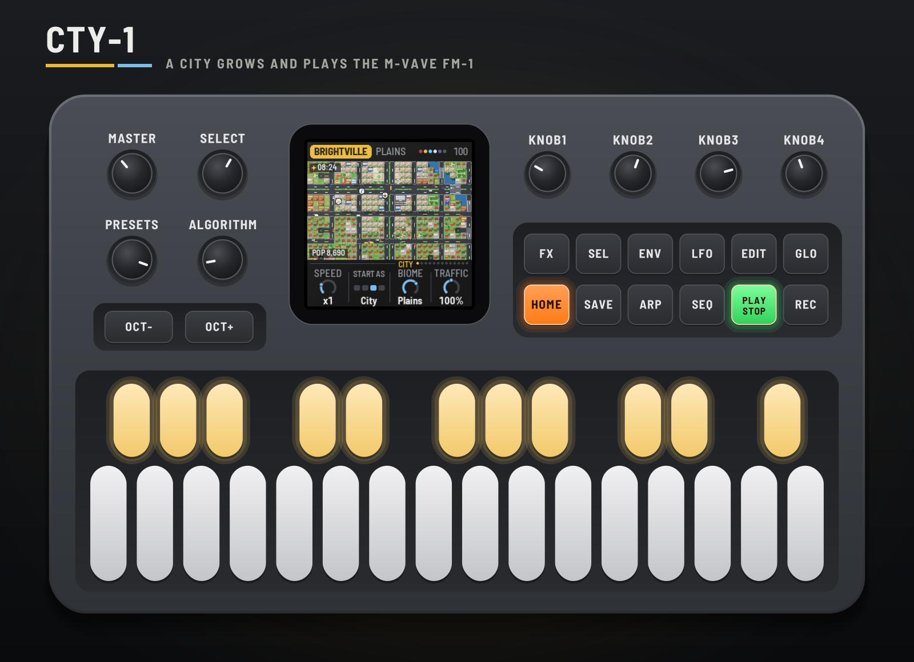

---

## Contents

1. Install
2. Getting started
3. Controls
4. The screen
5. How the city grows
6. How the city plays
7. The biomes
8. The pages
9. MIDI clock and your DAW
10. Saving
11. Troubleshooting
12. Credits

---

## 1. Install

**Try it first:** the emulator runs the same code in the browser, with sound, played with the mouse, a
touch screen or the keyboard.

**Install:** open the installer in Chrome or Edge, connect the FM-1 with a USB data cable and press
Install. Don't unplug it while it's writing; when it finishes, the FM-1 restarts into CTY-1.

From the command line instead (needs `pip3 install mido python-rtmidi`):
`python3 tools/fm1_install.py cty1-VERSION.fwsc`, with the file from the site's download.

**Go back:** "Back to the stock firmware", at the bottom of the installer, puts M-VAVE's firmware back.
M-VAVE's own updater, M-UPGRADE, works too.

> Installing other firmware is at your own risk. If the FM-1 won't start, hold OCT− and OCT+ together for
> five seconds for the update mode, then install again.

---

## 2. Getting started

CTY-1 starts by itself: the RedtailWorks card, then CTY-1 over a skyline lighting up, then the city. A few
minutes with it:

1. **Listen.** A new city has just been founded, its name and its land in the header: a crossroads, a few
   houses. Turn MASTER for volume. Each car is a playhead; each building it passes rings.
2. **Speed it up.** KNOB 1 on the City page is the speed: turn it to ×8 and watch the town spread. A message
   in the header names each first: the first shop, the town square, the fire station, a bridge.
3. **Play along.** The keys play a lead in the city's scale (the lit keys). OCT− / OCT+ move it.
4. **Make something happen.** Press FX for Events. Black key 1 calls lightning, 2 an earthquake, 3 a
   robbery, 4 a crash, 5 a UFO, 6 birds, 7 the land's own disaster, 8 a festival, 9 a blackout, 10 meteors.
   The camera goes there and stays until it's over.
5. **Change the sky.** Press LFO: black keys 1–4 jump to dawn, noon, dusk and night. Press it again for
   Weather: black keys 1–7 set it, from Auto to snow.
6. **Try another land.** Turn PRESETS: a new city in the next biome, with its music. EDIT founds another
   on the same land. Switch off and on: a new one again.
7. **Leave it.** After a minute untouched the city takes the whole screen and rides along with its cars.

---

## 3. Controls

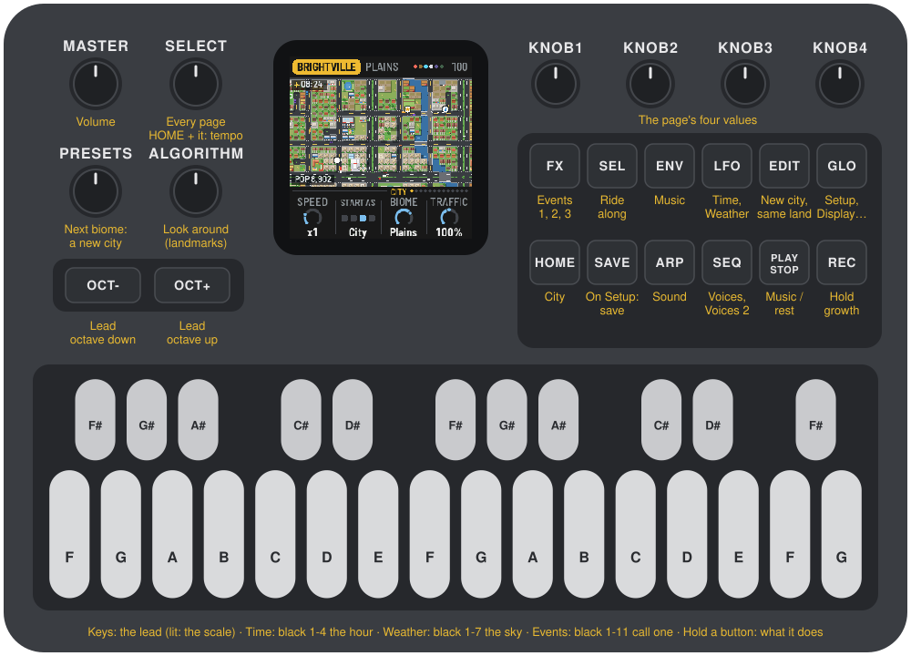

| Control | What it does |
|---|---|
| **Keys** | The lead, kept to the city's scale (lit). On Time, black keys 1–4: dawn, noon, dusk, night. On Weather, black keys 1–7: Auto, then the land's six weathers. On the Events pages, black keys 1–10: lightning, an earthquake, a robbery, a crash, a UFO, birds, the land's disaster, a festival, a blackout, meteors. |
| **PLAY** | The music plays / rests. The city lives on either way. |
| **REC** | Hold: the city stops growing (HOLD in the header); life and the music go on. Again to let it grow. |
| **EDIT** | A new city on the same land. |
| **HOME ENV ARP LFO SEQ FX GLO** | The pages: City, Music, Sound, Time (again: Weather), Voices (again: Voices 2), Events (again: Events 2, Events 3), Setup (again: Display, then MIDI out). |
| **SEL** | Ride along: the camera follows a car on screen (again: another). Held, with GLO: remote (the panel plays the browser emulator). |
| **SELECT** | Every page in turn. With HOME held: the tempo. |
| **ALGORITHM** | Look around: the camera to each landmark in turn (the town hall, the school, the stadium…), staying a few seconds. |
| **PRESETS** | The next biome (or the one before): a new city there, with the biome's music. |
| **KNOB 1–4** | The page's four values. |
| **OCT− / OCT+** | The lead an octave down / up (two each way). |
| **SAVE** | On the Setup pages (Setup, Display, MIDI out): saves your settings for every power-on. Elsewhere: the city again from its founding. Hold 1.5 s: the biome's music back (tempo, flavor, lead, swing, echo, density, bed). |
| **MASTER** | Volume. |

Hold any button for a second and a card says what it does. MIDI notes in play the lead too.

---

## 4. The screen

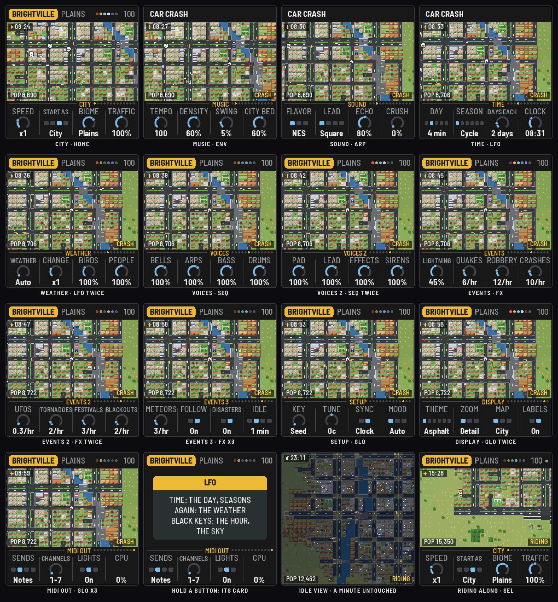

- **The header:** the city's name in a tag, its land and what it is now (DESERT CITY), then on the
  right the six chip channels as dots (lit as they play; resting, a play triangle), HOLD while growth is
  held, the tempo (EXT and the clock's tempo on MIDI clock) and a dot while something is unsaved. Messages
  take its place for a moment: what opens, what happens.
- **The city,** from above. Roads, avenues with planted medians, roundabouts, cul-de-sacs, bridges and the
  beltway; houses with yards, townhouses, apartments and towers; corner stores, shopping centres, offices and
  glass skyscrapers; workshops, warehouses, factories with smoking stacks, power plants; farms; and the
  landmarks, each easy to tell: the town hall's dome, the school's running track, the hospital's red cross,
  the fire and police stations, the railway station, the stadium, parks, ponds, a marina, a golf course.
  Cars, buses and trucks on the roads, people on the pavements, birds overhead, clouds' shadows drifting.
  Day turns to night (windows, streetlights, headlights), the seasons colour the trees and fields, and snow
  settles on the roofs.
- **The labels** (Display: Labels): the hour and the sky top left, the population bottom left, and bottom
  right what the camera follows: RIDING, FIRE, QUAKE, ROBBERY, CRASH, UFO, GROWING (Start as), HOLD.
- **The knob strip:** the page's name and the walk's dots, then the four knobs. The one being turned lights
  up.

**The camera.** On Detail it fits the whole city while it's small, then tours the newest and tallest
buildings, a new one every few seconds; Close stays near; Whole shows it all. An incident takes it (Follow);
SEL rides with a car; ALGORITHM looks at the landmarks.

**The idle view.** Untouched for a minute (Idle), the city takes the whole screen. The camera rides with one
car after another, its route singing the lead, cutting to the incidents as they happen, and the lights play
along: each chip channel a page button and the key of its note, OCT− and OCT+ the beats, GLO the lightning,
SAVE an incident. Any touch brings the pages back.

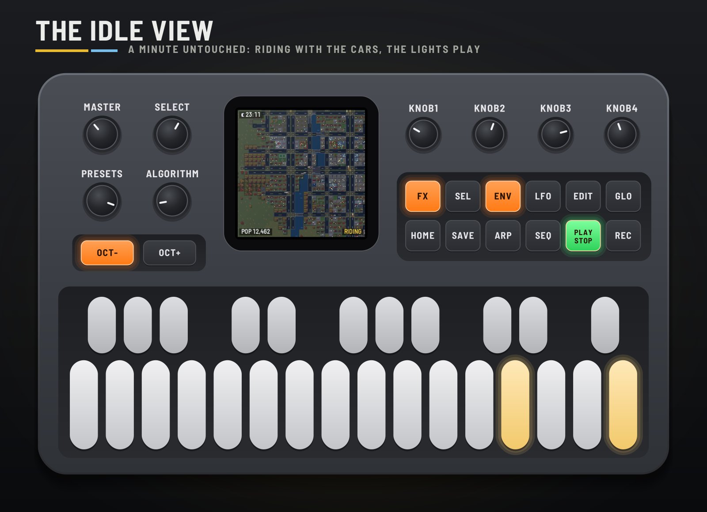

---

## 5. How the city grows

- **Founding.** A seed makes the land: hills, woods, a coast on one side or a river across, sometimes both,
  and a name. The town starts at a crossroads near the middle.
- **Roads.** The plan is laid out ahead: blocks small at the centre and larger outward, two-lane avenues with
  planted medians every few blocks, roundabouts where they cross, cul-de-sacs at the edges. Roads reach out as
  the town needs land, bridging the river (and, as a city, a causeway over the bay). At the City stage a
  beltway opens round it.
- **Building.** Each week lots are built where they're worth most: land value rises near the centre, the
  avenues, water and parks, and falls near factories. Homes, shops and offices, and industry try to keep to
  their own districts (the industrial side away from the water), with some mixing. Rent and jobs set the
  balance: too few jobs and shops and factories come; too few homes and houses do. Farms spread at the edge
  and give way as the city reaches them. Small buildings grow into bigger ones, neighbours merge into
  shopping centres, office campuses and skyscrapers, and old lots are cleared and redeveloped.
- **Landmarks.** As the population passes each mark, a gas station, the town hall, a fire station, a police
  station, a school, a hospital, the railway station and the stadium open, plus green spaces: parks, pocket
  parks, playgrounds, gardens, plazas, ponds, playing fields, a cemetery, a marina on the coast, a golf
  course.
- **Stages.** Town, Suburb, City, Huge city: each changes the music (below) and the headline.

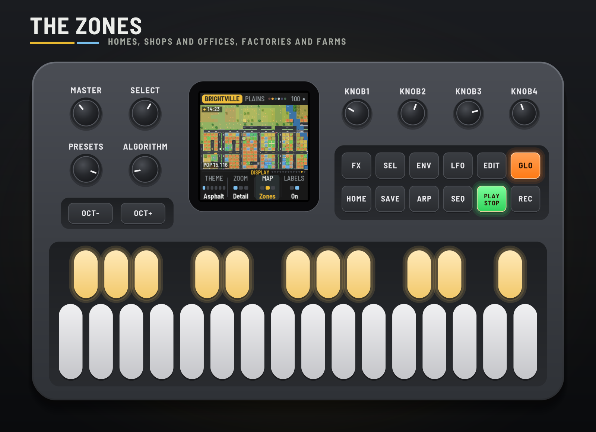

### The land

Each power-on picks a biome (City: Biome, Random by default) and a seed, and the seed draws the land:

| Biome | The land | Its weather | Its disaster |
|---|---|---|---|
| **Forest** | Deep woods of oaks and pines, a river | Thunderstorms, mist, snow | **Wildfire:** it runs through the woods; what's in its way catches, the brigade comes; burnt woods stay cleared |
| **Desert** | Sand, red mesas, cacti, palms by the water | Dust storms, heat haze, a rare shower or frost | **Dust devil:** a whirl of sand wanders through town |
| **Alpine** | A valley under rock and snowy peaks, pines, a stream | Blizzards, low cloud, snow most of the year | **Avalanche:** the snow lets go off a mountain into the valley |
| **Volcano isles** | Islands in a turquoise sea, palms, black sand, a smoking volcano | Typhoons, ash haze, ash fall | **Eruption:** lava runs downhill and the ash rises |
| **Plains** | Golden grass, farms, a few groves | Thunderstorms, fog, snow | **Tornado:** the siren, then a twister across town (more in a storm) |
| **Beach** | A long sandy shore, dune grass, palms | Tropical storms, sea fog, sleet | **Tsunami:** the siren, a wave line comes in, the shore floods and drains |
| **River lands** | A wide river, a tributary, ponds and reeds | Thunderstorms, mist, snow | **Flood:** the river rises over its banks (more in the rain) |

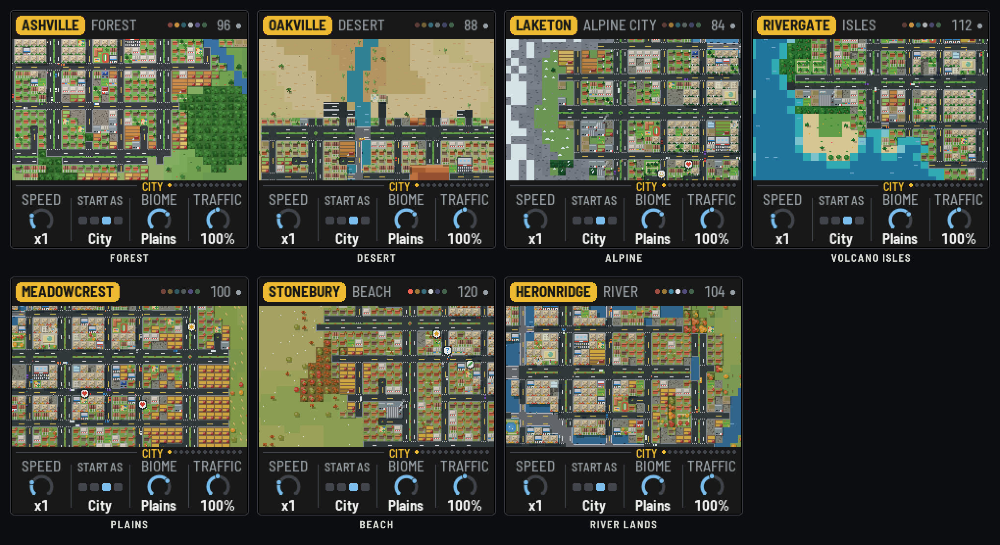

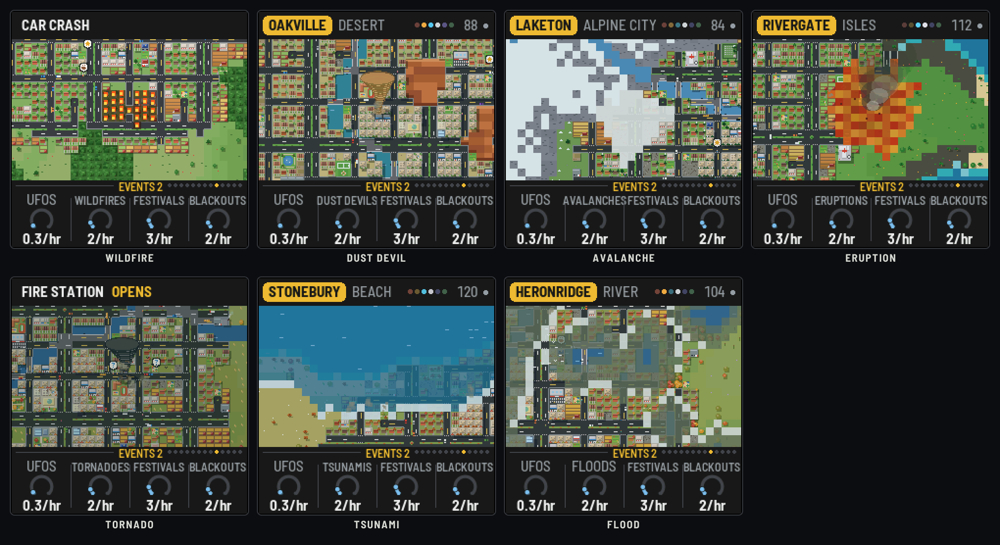

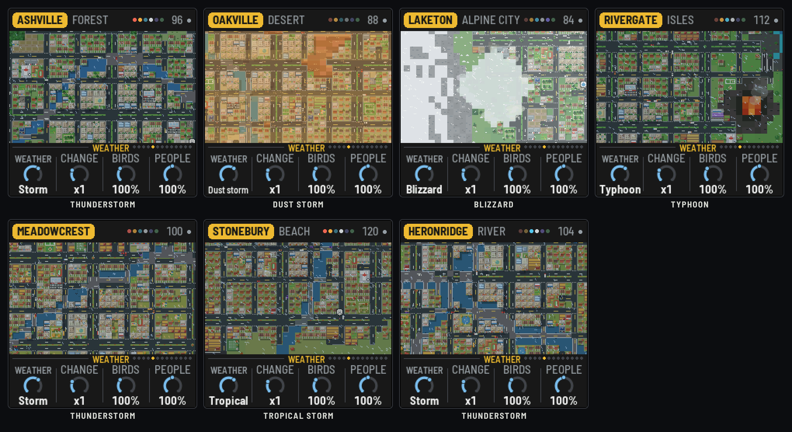

### Life

Cars drive real routes on the roads from homes to work and shops, more at the rush hours, fewer at night and
in the rain. Buses and trucks too. People walk the pavements and stroll the parks; two who meet may stop and
talk in speech bubbles (a heart, a note, coffee, the sun, a frown…), each a chirp in the music. Birds fly over
in flocks, gulls by the sea.

### The day and the seasons

A day lasts 2–16 minutes (Time: Day), or it can stay noon. Seasons go round every few days (Cycle), follow
the calendar, or stay put: blossom in spring, autumn colours, bare trees and snow in winter, the crops
changing. The weather follows the season (Auto), changing as often as Change says: clear, cloudy, rain,
storms, fog, snow.

### Incidents

- **Lightning** strikes out of rain, storms and snow (not dust or ash), and may set a building alight (in the
  forest, the woods). The nearest fire station sends its truck
  along the roads; it hoses the fire out, or the building burns down and its lot is cleared.
- **An earthquake** shakes the screen and gates the music in time; a few buildings fall. Their rubble is
  cleared at the start of the next four-bar phrase, and the lots are built again.
- **A robbery:** a robber walks to a shop and an alarm rings. The police drive over and catch them, or they
  get away.
- **A crash:** two cars collide. An ambulance comes from the hospital, then the wreck is towed.
- **A UFO,** very rarely, flies in and beams someone up.
- **A festival:** a crowd round a plaza or a park, confetti by day, fireworks at night; the music gets a
  fanfare, a tambourine and doubled arpeggios.
- **A blackout** at night: a district's windows and streetlights go out, the pad drops and the filter
  closes, then the lights flicker back.
- **A meteor shower** on a clear night: shooting stars, each a falling chime.
- **The land's own disaster** (above).

How often each happens is on the Events pages (Disasters stops them destroying); black keys call them at
once. With Follow on, the camera goes to each and stays until it's over.

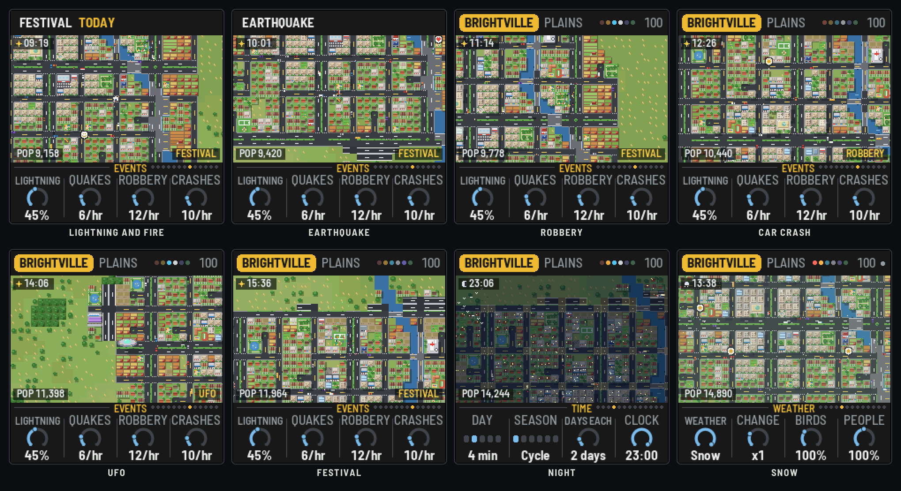

---

## 6. How the city plays

The music runs on six chip channels: **Pulse A** (bells, sirens, the lead), **Pulse B** (arpeggios, birds),
the **triangle** (kick and bass), **noise** (hats, snares, the beltway's hiss, fire's crackle), the **wave**
(the pad) and the **lead**, voiced by Flavor as an NES, a Game Boy or a SID.

- **The bed** follows the stage: a town has a kick and a slow bass under a pad; a suburb adds hats and a
  moving bass; a city a snare backbeat; a huge city busy hats and an octave-jumping bass. The chord moves
  through the city's progression, and a fill and a rise up a fourth mark each new stage.
- **The cars are playheads.** Each tile a car crosses sets the rhythm of the road; each building beside it
  rings in its own voice: homes soft bells, shops bright arpeggios, industry low thuds, the landmarks their
  own short motifs (the town hall a fanfare, the school a chime, the hospital two notes…). New buildings
  clink, towers rise, parks swell.
- **The land** sets the sound: each biome its own ladder of modes (the city's mood climbs or falls it), its own
  percussion, its own bass, and its music recipe (tempo, flavor, lead, swing, echo):

  | Biome | Modes, bright to dark | Rhythm and bass | Recipe |
  |---|---|---|---|
  | Forest | Ionian, Mixolydian, Dorian, Aeolian | Woodblocks; the usual bass | GB wave, 96 BPM, long echo |
  | Desert | Mixolydian, Hijaz, harmonic minor, Phrygian | A hand drum (doum and tek); a drone on the root | SID saw, 88 BPM |
  | Alpine | Lydian, Ionian, Dorian | A cowbell; long bass notes; the pad up | NES thin pulse, 84 BPM, the longest echo |
  | Volcano isles | Ionian, Mixolydian, Dorian, Phrygian; pentatonic tunes | Son clave and a steel drum; syncopated bass | GB wave, 112 BPM, swung |
  | Plains | Ionian, Mixolydian, Dorian, Aeolian; pentatonic tunes | Boom-chick: root and fifth, a chick on 2 and 4 | NES square, 100 BPM |
  | Beach | Lydian, Mixolydian, Dorian, Aeolian | A surf backbeat, a tambourine; a walking bass | NES square, 120 BPM, a short echo |
  | River lands | Lydian, Ionian, Dorian, Aeolian; pentatonic tunes | Rolling shakers; long bass | GB wave, 104 BPM, long echo |
- **The mood** of the city (homes against jobs, rent, the night, the weather, a disaster or a festival) climbs
  or falls the land's ladder of modes.
- **The sky:** night closes a lowpass over everything and makes the pad louder; fog closes it more and
  lengthens the echo; rain and snow fall as filtered noise; birds overhead shorten the echo and chirp.
- **The incidents:** sirens wail in key (the fire truck, the police, the ambulance), an alarm rings, thunder
  rolls, a quake gates the whole mix, the UFO sings its own wavering tune. A tornado or a tsunami sets off
  the civil-defense siren; dust storms, blizzards and typhoons blow as a wandering wind; lava, avalanches,
  waves and floods rumble.
- **The lead** on the keys snaps to the scale with a slow vibrato. In the idle view, the car the camera rides
  with plays it.

---

## 7. The biomes

There are no preset cities: every power-on founds a new one, on a new seed. **Biome** (City page) picks the
land: Random, or one of the seven. **PRESETS** moves to the next biome at once (a new city there, with its
music); **EDIT** founds another on the same land; **SAVE** elsewhere than Setup grows the same city again
from its founding. Your settings (SAVE on Setup) carry over to every new city, except the music recipe each
biome brings: hold SAVE to get it back after changing it.

---

## 8. The pages

### City (HOME)

- **Speed:** ×¼ to ×64; at ×1 about a week a second.
- **Start as:** a new city grows at once to a Town, Suburb, City or Huge city (GROWING shows meanwhile).
- **Biome:** the land each power-on founds a city on: Random, or Forest, Desert, Alpine, Isles, Plains,
  Beach, River.
- **Traffic:** how many cars, 0–200%.

### Music (ENV)

- **Tempo:** 60–160 BPM (also HOME + SELECT).
- **Density:** how many of the city's events become notes.
- **Swing:** the off-beats late.
- **City bed:** the drums, bass and pad under it all.

### Sound (ARP)

- **Flavor:** NES (pulses, a 4-bit triangle), GB (a wave table), SID (saws, pulses, a filter that follows
  the city's brightness).
- **Lead:** the keys' voice: Square, Thin, Wave or Saw.
- **Echo:** how much echo (fog and snow lengthen it; birds shorten it).
- **Crush:** the levels stepped, grittier as it rises. A run-down city adds some itself.

### Time (LFO)

- **Day:** a day's length: 2, 4, 8 or 16 minutes, or always noon.
- **Season:** Cycle, Calendar, or Spring, Summer, Autumn, Winter.
- **Days each:** in Cycle, how many days a season lasts.
- **Clock:** the hour now; turn it to move the sun. Black keys 1–4: dawn, noon, dusk, night.

### Weather (LFO again)

- **Weather:** Auto (by the season and the land), or one of six, named as the land has them: clear; cloudy
  (haze in the desert); rain (a shower); the storm (a thunderstorm, a dust storm, a blizzard, a typhoon, a
  tropical storm); fog (mist, heat haze, low cloud, ash haze, sea fog); snow (frost, ash fall, sleet). Black keys
  1–7 set it.
- **Change:** how often Auto changes it.
- **Birds:** how often flocks fly over.
- **People:** how many people, 0–200%; they stop to talk in speech bubbles.

### Voices (SEQ) and Voices 2 (SEQ again)

Each part's level, 0–150%: **Bells, Arps, Bass, Drums**; then **Pad, Lead, Effects** (weather, birds,
thunder, the UFO) and **Sirens** (and alarms).

### Events (FX), Events 2 (FX again), Events 3 (FX a third time)

- **Lightning:** the chance a strike starts a fire (it strikes out of rain, storms and snow).
- **Quakes, Robbery, Crashes:** how many an hour (of the city's day).
- **UFOs:** very rare by default.
- **The land's disaster** (named for it: Wildfires, Dust devils, Avalanches, Eruptions, Tornadoes, Tsunamis,
  Floods): how many an hour, more in its weather.
- **Festivals, Blackouts, Meteors:** how many an hour (blackouts and meteors at night).
- **Follow:** the camera goes to each incident.
- **Disasters:** whether fires, quakes and the land's disasters destroy.
- **Idle:** the idle view after 1, 2 or 5 minutes, or never.

Black keys 1–10 on any of them: lightning, an earthquake, a robbery, a crash, a UFO, birds, the land's
disaster, a festival, a blackout, meteors.

### Setup (GLO), Display (GLO again), MIDI out (GLO a third time)

- **Setup:** Key (Seed: from the city's seed; or C to B), Tune (cents), Sync (Off or Clock), Mood (Auto, or
  kept Bright or Dark).
- **Display:** Theme (Asphalt, Neon, Blueprint, Sunset, Terminal, Mono: the frame; the city keeps its own
  colours), Zoom (Detail, Close, Whole), Map (the City, its Zones, its land Value), Labels.
- **MIDI out:** Sends (Off, Notes, Both, CCs), Channels (which seven), Lights (the key lights), CPU (the
  audio load).

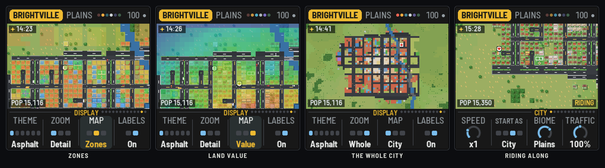

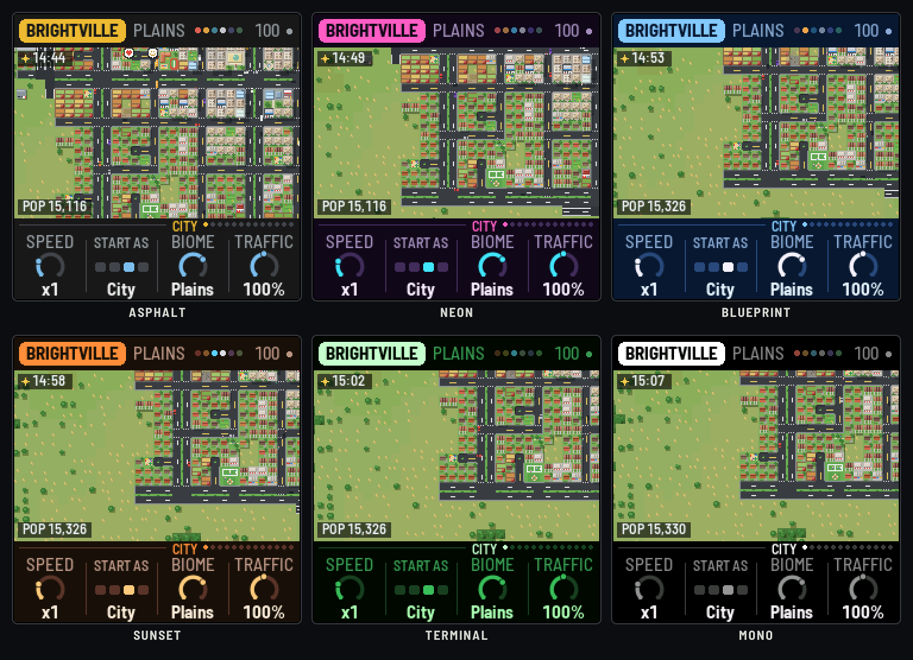

---

## 9. MIDI clock and your DAW

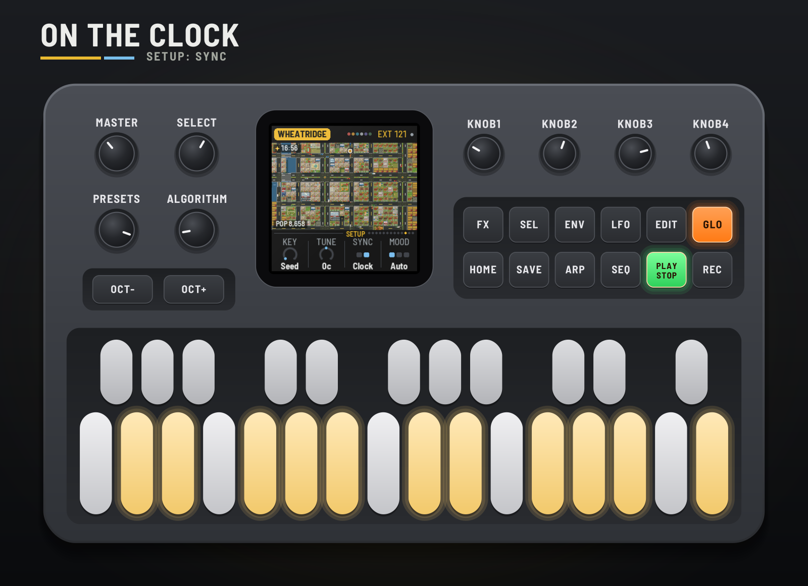

**Clock in** (USB or the TRS jack). With Sync on Clock, CTY-1 follows MIDI clock whenever it comes: EXT and
the tempo show top right. START plays from step one, STOP rests it. When the clock stops, the city goes back
to its own tempo.

On USB the FM-1 shows up as **CTY-1 FM-1** (by RedtailWorks); each firmware in the pack has its own name.
(Windows may go on showing a name it saw before until the FM-1 is unplugged and removed in Device Manager.)

**MIDI in:** notes play the lead.

**MIDI out** (USB). On the MIDI out page, Sends picks what goes out:

| Channel (default) | What |
|---|---|
| 1 | Pulse A: bells, sirens |
| 2 | Pulse B: arpeggios, birds |
| 3 | Triangle: kick and bass |
| 4 | Noise: the drums, as a kit (36 kick, 38 snare, 42 hat, 45 tom, 49 crash) |
| 5 | Wave: the pad |
| 6 | The lead |
| 7 | The city, as CCs (when they change) |

| CC | Signal |
|---|---|
| 20 | Mood (0 struggling, 127 thriving) |
| 21 | Brightness |
| 22 | Rush (the traffic) |
| 23 | Daylight |
| 24 | Rain and snow |
| 25 | The stage (0 town, 42 suburb, 84 city, 126 huge city) |

**Audio per voice** is in the emulator for now: choose "8 channels" under its device and it gives the mix on
1–2, then 3 Pulse A and the lead, 4 Pulse B, 5 the triangle, 6 the noise, 7 the wave and the UFO, 8 the rain
and the echo. The FM-1 itself sends the stereo mix from its output.

**Remote: the FM-1 plays the emulator.** Open the [emulator](https://rustypawz.github.io/fm1-HYP1/cty/emu/),
switch it on and click Connect MIDI (Chrome or Edge, the FM-1 plugged in by USB). Then hold SEL and press GLO
on the FM-1: REMOTE shows on its screen, it goes quiet and stops sending MIDI, and its whole panel (every
button, key and knob, and MASTER) plays the emulator instead, its lights following the emulator's. SEL + GLO
again gives the FM-1 back, playing again if it was. It speaks on channel 16, as the other firmwares' remotes
do. For livestreams, the emulator's **Stream view** shows the FM-1 and its screen large on a 16:9 stage over
the city's own sky and skyline, with whatever you press on the real one lit up.

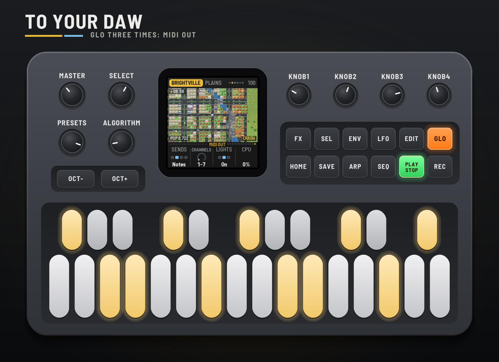

---

## 10. Saving

What you change is kept while the FM-1 is on. Press SAVE on the Setup, Display or MIDI out page to keep
your settings through a power-off (a dot top right shows something is unsaved). The city itself isn't kept:
each power-on founds a new one (Start as grows it to a stage at once), and its biome brings its music recipe.

---

## 11. Troubleshooting

- **No sound:** turn MASTER up; check PLAY is lit (press it to play); check the levels on the Voices pages.
- **The city stopped growing:** REC (hold) may be on: HOLD shows in the header. Or every lot is built: the
  header said EVERY LOT BUILT.
- **No incidents:** check the Events pages (and Disasters); lightning only strikes in storms.
- **The camera won't stay put:** Follow (Events 2) takes it to incidents; turn ALGORITHM to look around.
- **The clock does nothing:** Sync must be Clock (Setup). EXT shows while the clock comes.
- **No MIDI out:** Sends must not be Off, and your DAW must listen on channels 1–7 (or the ones you chose).
- **The FM-1 won't start:** hold OCT− and OCT+ together for five seconds for the update mode, then install
  again.

---

## 12. Credits

CTY-1 is a RedtailWorks project. It's a fork of [AMB-1](https://github.com/charlesvestal/fm1-amb) by Charles
Vestal, by way of HYP-1, ECO-1 and GRAV-1. The platform (USB, update loader, storage, installer) is
[Felucca](https://github.com/hugelton/Felucca) by Leo Kuroshita (@kurogedelic), Hügelton Instruments. Screen
font: Barlow Semi Condensed (SIL OFL). GPL-3.0.

M-VAVE and FM-1 are trademarks of their owners; CTY-1 is not affiliated with M-VAVE.

Pilots: hold the selector and edit the sky.
