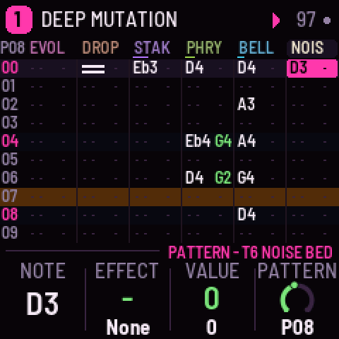
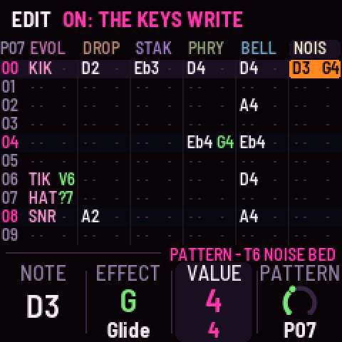
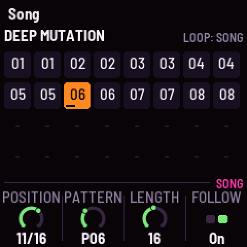
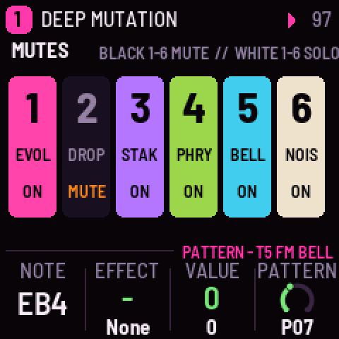

# EVOL-1 for the M-VAVE FM-1 (experimental)

EVOL-1 turns the M-VAVE FM-1 into a tracker built round the sound of *Evol*, RedtailWorks' album: dark,
sub-heavy, slow-moving electronics. Six tracks of sixteen rows, a note and an effect a cell, patterns chained
into a song, played by the album's own palette: soft sine kicks falling from 120 Hz, the Eb harmonic stack over
D, pads pumping at the tempo, FM bells on fourths and fifths, a phrygian lead gliding a semitone, a throat in
the low mids, glitches and noise, through a dotted-eighth ping-pong and a long dark plate. Evolve lets each
pattern drift a little on every pass; Grow writes one in the album's ways. A RedtailWorks project, alongside
HYP-1 in this repository.

> **Experimental.** Built and tested in the simulator and the browser emulator, not yet on a real FM-1.
> Versions are 0.x until it has been. Install it at your own risk; HYP-1 or M-VAVE's firmware goes back on
> the same way.

| | |
|---|---|
|  |  |
|  |  |

- **Try it in the browser:** <https://rustypawz.github.io/fm1-HYP1/evol/emu/>: with sound, MIDI in and
  out, and eight channels (the tracks apart) for your DAW.
- **Install it** (Chrome or Edge, the FM-1 plugged in): <https://rustypawz.github.io/fm1-HYP1/evol/install/>
- **Manual:** <https://rustypawz.github.io/fm1-HYP1/evol/manual/> (source: [docs/MANUAL.md](docs/MANUAL.md))

## In short

| | |
|---|---|
| Keys | The cursor's track (a kit: white keys 1–8 its drums). With REC on, they write and the cursor steps down; playing, into the row playing |
| PLAY · REC · EDIT | Play / stop (SEL: from the row) · edit · clear the cell (SEL: a note-off; on Grow: grow; on Song: a fresh copy) |
| HOME · SEQ · ENV · LFO · ARP · GLO | Pattern · Song · Sound (again: Move, Sends) · Space (again: Groove) · Grow · Setup (again: Device) |
| SELECT · ALGORITHM · PRESETS | The row (Song: the position; HOME held: tempo) · the track · the song (five) |
| KNOB 1–4 | The page's values; on Pattern, the cell's note, effect and value, and the position's pattern |
| FX · SEL | Mute the track (held: black keys mute, white keys solo) · follow the song (held: shift) |
| OCT− / OCT+ | The keys' octave (SEL: the cell a semitone) |
| SAVE | Save the song; held on Setup: the song as it came |

**Sixteen effects:** Glide, Chance, Ratchet, Delay, Tone, Volume, Bend, Echo throw, Chord, Mutate, Length,
Crush, Stutter, Swell, Jump. **Twenty-four sounds:** three kits (Evol, Ritual, Glitch), Sub root, Drop bass,
Pulse bass, Reso bass, Eb stack, Pump pad, Wide pad, Throat, Sweep, Cold choir, FM bell, Dark pluck,
Phrygian, Glass, Hollow, Noise bed, Glitch, Static, Wind, Bugs, Rumble. **Five songs,** each after a track
of the album at its measured tempo and key: Deep Mutation, Psychic Weather, Ritual, The Garden, bugs.

**To your DAW:** MIDI clock in (USB or TRS) drives the rows, six ticks a row; MIDI out sends each track's notes
on its own channel, and the clock when asked. Notes in play and write the cursor's track.

## The sound, from the album

The sound bank and the songs were modelled on measurements of the album's sixteen tracks (spectra, tempo,
key, low-end weight, pulsing, stereo width, reverb tails), not on samples: no audio from the album is in
this tree. The songs as they come land in the album's measured ranges: most of their energy under 150 Hz,
a spectral centroid of a few hundred hertz, a side-to-mid ratio of 0.15 to 0.5.

## Storage

Each song is its own flash object (3.3 KB: sixteen patterns of 16 × 6 cells of two bytes, the order list,
the song's settings), with Felucca's A/B copies so a power cut mid-save keeps the last good one. Songs 1–4
live at 0x97000–0x9EFFF and song 5 at 0xDE000, clear of the sample slots (0xA0000–0xDBFFF) M-VAVE's own
firmware keeps; the device's settings are in the project object at 0xFC000.

## Building

Self-contained in this folder: see [BUILDING.md](BUILDING.md). HYP-1's workflow
(`../.github/workflows/firmware.yml`) builds it on every push, after HYP-1. Licensing:
[LICENSING.md](LICENSING.md) (GPL-3.0-only).

EVOL-1 is a fork of [AMB-1](https://github.com/charlesvestal/fm1-amb) by Charles Vestal, by way of HYP-1 and
GRAV-1, on [Felucca](https://github.com/hugelton/Felucca) by Leo Kuroshita (@kurogedelic), Hügelton
Instruments. M-VAVE and FM-1 are trademarks of their owners; EVOL-1 is not affiliated with M-VAVE.
